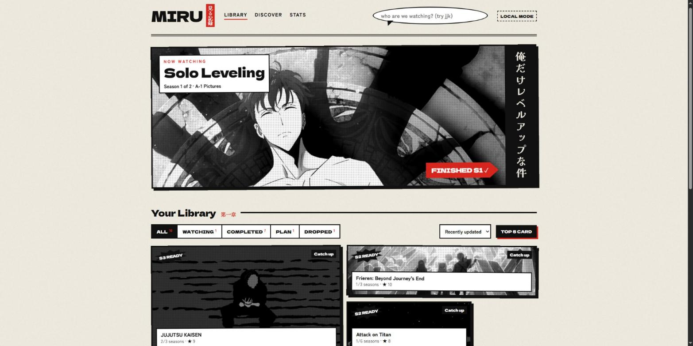
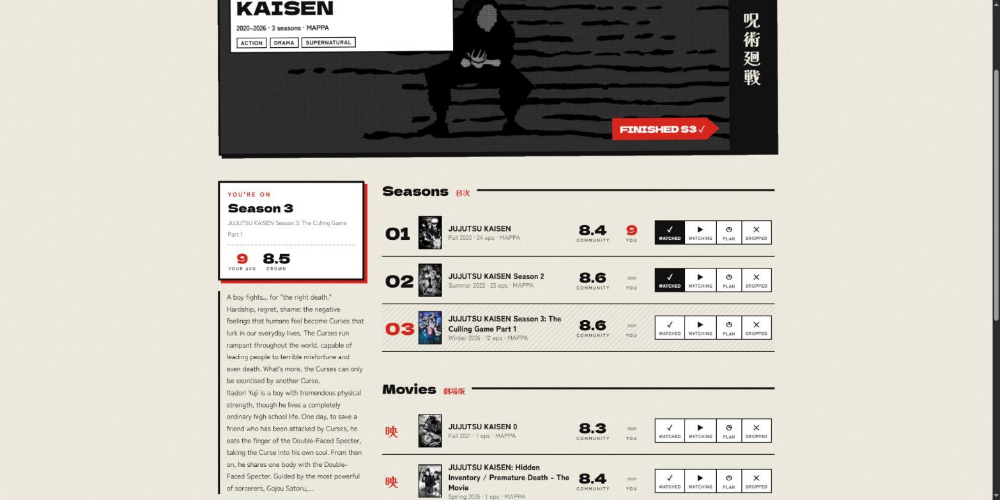
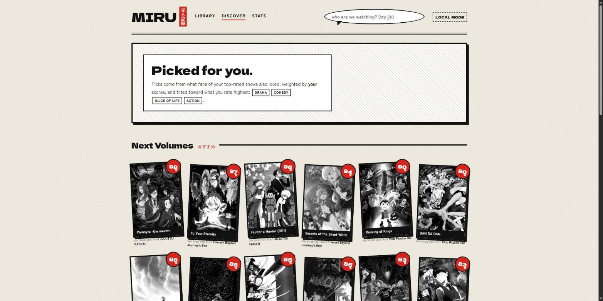
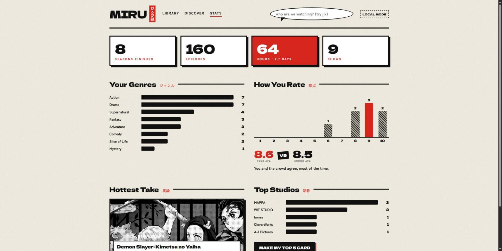

# MIRU 見る記録

**A manga-styled anime tracker and recommender.** Track every show season by season, rate each season, and get recommendations that explain themselves.

**Live:** https://fahranalam04-cmd.github.io/miru/



## What it does

- **Per-season tracking, no episode counting.** Add a show and click "I'm on S3": seasons 1–2 are marked watched and S3 watching. A single "Finished S3 ✓" button moves you forward.
- **Rate every season** on a 1–10 scale, next to AniList's community score.
- **Shorthand search.** `jjk` finds Jujutsu Kaisen, `fmab` finds Fullmetal Alchemist: Brotherhood, `aot` finds Attack on Titan. Typos fall back to a looser search.
- **Always current.** Data comes live from AniList. When a sequel is announced or starts airing, your finished shows get a **NEW SEASON** badge, and airing seasons show a countdown to the next episode.
- **Recommendations with reasons.** "98% match: because you liked Vinland Saga." See [how it works](#how-recommendations-work).
- **Stats.** Hours watched, top genres and studios, your rating distribution, how you compare with the crowd, and your "hottest take".
- **Top 5 share card.** Renders a 1080×1350 manga page of your favourites, ready to post.
- **Sync with AniList.** Sign in to save your list to your AniList account and use it on any device. Without signing in, it saves in your browser.

| Show page | Discover | Stats |
|---|---|---|
|  |  |  |

## How it works

### Seasons → shows
AniList stores every season as its own entry, connected by `PREQUEL`/`SEQUEL` relations. MIRU walks that graph breadth-first, fetching each ring of neighbours in **one batched GraphQL request** (up to 50 ids). It then groups connected entries with union-find and orders them by air date. TV/ONA entries become seasons and films become "Movies". Results are cached, and stale entries refetch after 12 hours, which is how new sequels appear without any manual updates.

### How recommendations work
1. **Community signal:** for your top-rated shows, it pulls AniList's "fans also liked" lists, weighted by `(your score − 5)` × `log(community votes)`.
2. **Taste profile:** genres you rate *above your own average* push a candidate up, and genres you rate below it push it down.
3. **Cleanup:** it drops anything you've already tracked, later seasons of other shows, and anything connected to your library. The top result's strongest source becomes the "because you liked …" reason.

A second shelf ranks the **currently airing season** by the same taste profile.

### Being polite to the API
A client-side limiter caps requests at 25 per minute and honours `Retry-After` on HTTP 429. Show data, recommendations, and groupings are cached in `localStorage`.

## Tech

React 19 · TypeScript · Vite · AniList GraphQL API · OAuth 2 implicit grant · Canvas 2D (share card) · GitHub Actions → GitHub Pages. There's no backend and no UI library; the manga ink look is hand-written CSS (halftone screentones, panel layouts, vertical Japanese type).

```
src/
  api/anilist.ts      GraphQL client, rate limiter, queries
  lib/franchise.ts    season graph → shows (BFS + union-find)
  lib/store.ts        state, local persistence, AniList sync
  lib/derive.ts       current season, show status, NEW SEASON badges
  lib/recommend.ts    recommendation engine + taste profile
  lib/stats.ts        stats page numbers
  lib/shareCard.ts    canvas renderer for the Top 5 card
  pages/, components/ UI
design/mockups/       the four visual directions explored before building
```

## Run it locally

```bash
npm install
npm run dev        # http://localhost:5173/miru/
```

To enable AniList sign-in, create a client at <https://anilist.co/settings/developer> with the redirect URL set to your site (e.g. `http://localhost:5173/miru/`). Then:

```bash
echo VITE_ANILIST_CLIENT_ID=12345 > .env.local
```

For the deployed site, set the same id as an Actions variable named `ANILIST_CLIENT_ID`.

## Design

Four directions were mocked up with live data before any app code was written: Manga Ink, Neo-Tokyo, Shōnen Weekly, and Ukiyo-e (see `design/mockups/`). Manga Ink won: paper texture, heavy ink borders, halftone dots, one red accent. Cover art stays in grayscale and blooms into color on hover.

---

Anime data and images © their owners, served by [AniList](https://anilist.co). MIRU is a fan project and isn't affiliated with AniList.
